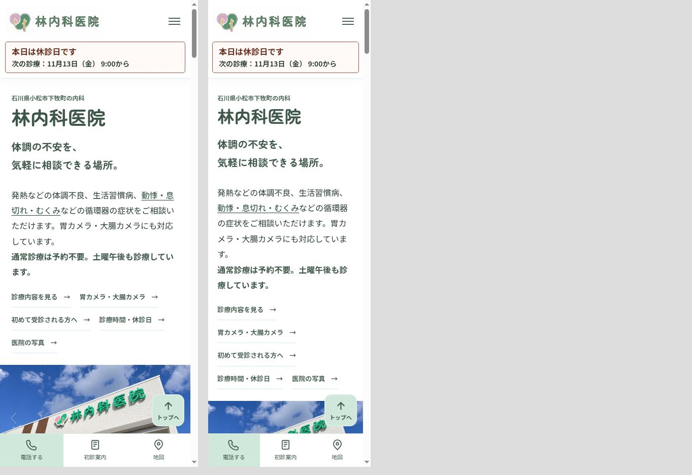
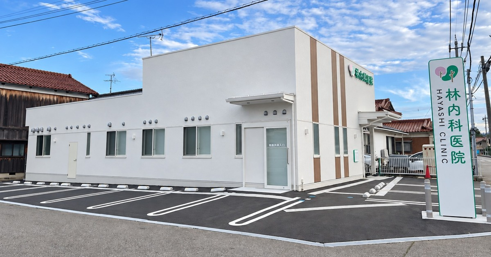

# 公開前の表示確認（2026-11-12）

対象ブランチ：`codex/patient-accessibility-20261112`。mainへのマージ・本番公開は行っていません。

## 表示確認

このリポジトリにはPRごとのプレビューを公開するワークフローがありません。既存の`Check static assets`は検証専用です。公開ガイドはGitHub Pagesの公開元をmain/rootとしています。今回、Pages設定・Actions設定・CNAMEは変更していません。管理画面のPages設定そのものは、この接続権限では確認できませんでした。

手元で動作確認する場合：

1. GitHubでこのブランチを選び、Code → Download ZIPを選択して展開します。
2. 展開したフォルダでターミナルを開きます。
3. PythonがあるWindowsでは`py -m http.server 8765 --bind 127.0.0.1`を実行します。macOS/Linuxでは`python3 -m http.server 8765 --bind 127.0.0.1`です。
4. ブラウザで`http://127.0.0.1:8765/`を開きます。終了はターミナルでCtrl+Cです。

HTMLをダブルクリックするだけでは、診療状況や写真のJSON読み込みが動かない場合があります。上記のローカルHTTPサーバーを使用してください。医院の本番サイトには影響しません。

確認箇所：ページ上部の診療状況／写真と文字の初期表示／写真右下の停止・再開／停止中の左右矢印／アクセス欄／初診案内の「初診の流れ」の直前。

PC確認時の表示（写真は停止した時点のスライド）：

スマホ相当の幅390px・320pxでの表示：

## 掲載文言

### トップの紹介文

発熱などの体調不良、生活習慣病、動悸・息切れ・むくみなどの循環器の症状をご相談いただけます。胃カメラ・大腸カメラにも対応しています。

通常診療は予約不要。土曜午後も診療しています。

「動悸・息切れ・むくみ」から診療案内の既存「循環器の症状」へリンクします。循環器専門医という表記は追加していません。医師紹介の経歴・資格本文は変更していません。

### トップのdescription

meta description、og:description、twitter:description、WebPage構造化データのdescriptionを次の同一文にしています。下層ページのdescriptionは、それぞれのページに固有の内容を維持しています。

小松市下牧町の林内科医院。一般内科・生活習慣病、動悸・息切れ・むくみなどの循環器の症状、胃カメラ・大腸カメラに対応。通常診療は予約不要。土曜午後も18:30まで診療。木曜・日曜・祝日休診。発熱時は来院前にお電話ください。

### アクセス欄

車いすでのご来院・院内設備

駐車場から入口まで段差なくお入りいただけます。院内には、車いすで利用できるトイレがあります。

院内は靴のままお入りください。スリッパへの履き替えは不要です。

### 初診案内

ご来院時のご案内

靴のままお入りいただけます。履き替えは不要です。

駐車場から入口まで段差がなく、車いすで利用できるトイレもあります。

地図・駐車場を見る →

### 診療状況

見出し：本日の診療。リンク：診療時間・休診日 →

| 状態 | 表示 | 補足 |
| --- | --- | --- |
| 診療中 | 現在診療中です | 午前の受付は12:00まで／午後の受付は18:30まで |
| 開始前 | 本日は診療日です | 本日 9:00から診療します（午後のみの場合は13:30） |
| 昼休み | 午後は13:30から診療します | 午後の受付は18:30まで |
| 休診 | 本日は休診日です | 次の診療：{月日・曜日} {開始時刻}から |
| 受付終了後 | 本日の診療は終了しました | 次の診療：{月日・曜日} {開始時刻}から |
| 午前のみ | 上記の時刻に応じた表示 | 本日は午前のみ診療します。 |
| 午後のみ | 上記の時刻に応じた表示 | 本日は午後のみ診療します。 |
| 読み込み中 | 診療状況を確認しています | 診療時間・休診日をご確認ください |
| 取得失敗・JS無効 | 診療状況はお電話でご確認ください | 0761-24-6288 |
| 次の診療日を取得できない場合 | 状態に応じた表示 | 次回診療日はお電話でご確認ください |

スマホでは既存のヘッダー内表示を使い、上部の帯は重複表示しません。上部・スマホ・写真下・スクロール時の表示は同じ判定結果を参照します。

### 写真と文字

- 停止ボタン：写真の切り替えを停止
- 停止中：写真の切り替えを再開
- 手動操作：前の写真／次の写真
- キャッチコピー「体調の不安を、気軽に相談できる場所。」は文言を維持し、PC24px・スマホ20pxで即時表示します。
- 写真下「一般内科・生活習慣病・内視鏡検査」「小松市下牧町」は16pxで即時表示します。
- 写真の初回フェードと縁のぼかしを外し、切り替え時は前の写真を不透明なまま残して白抜けを防ぎます。
- OSで動きを減らす設定を使っている場合は自動切り替えを停止し、明示的な再開を受け付けます。
- 手動で停止した状態は、矢印操作・タブやページ履歴からの復帰でも維持します。

### OG画像

対象はindex、first-visit、care、tests、vaccines、checkups、doctorの7ページです。og:image、twitter:image、既存の構造化データ内の旧イラスト参照を、既存実写から書き出した1200×630pxのJPEGに変更しました。

画像の代替説明：林内科医院の外観と駐車場

## 検証と制限

- npm test：既存テスト一式と、新しい診療状況・スライド操作・7ページOGのテスト。
- ホームページの初回読み込み、遅延・取得失敗、削除済み写真の復活防止、履歴復帰は専用エントリーポイントでも検証。
- Chromium：PC表示、320px/390pxのiframeによるレスポンシブ表示、停止操作、スマホメニュー、初診設備案内。
- endoscopy.htmlとそのローカルCSS・JS依存ファイルは、変更前とバイト単位で一致。回帰テストでも固定しています。内視鏡ページのOGも今回は変更していません。
- Safari・iPhone・Android実機、スクリーンリーダー、SNS側のカード再取得は未確認です。SNSでの新画像の取得は、本番公開後に確認が必要です。

実装上はホームページ専用の`home-page.js`と`home-slideshow.js`を読み込み、除外対象の内視鏡ページに変更が波及しないようにしています。今後、共通のページ制御を修正するときは、ホームページ専用版への反映要否も確認してください。
